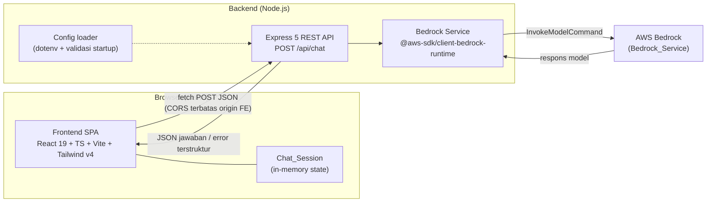
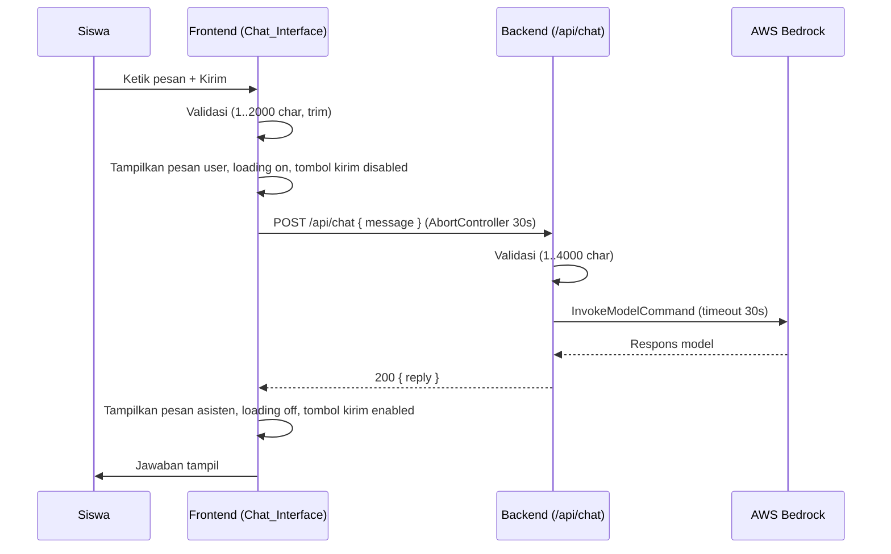
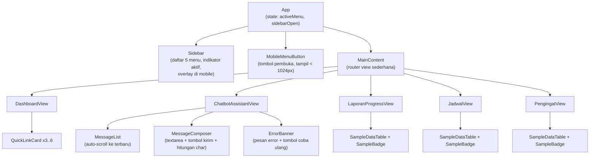

# Design Document

## Overview

Student Learning Assistant adalah aplikasi web chatbot asisten belajar yang terdiri dari dua bagian yang sudah tersedia di repositori:

- **Frontend** (`frontend/`): Single Page Application (SPA) berbasis React 19 + TypeScript + Vite 8, dengan Tailwind CSS v4 untuk styling. Menyajikan sidebar responsif dengan lima menu (Dashboard, Chatbot Assistant, Laporan Progress, Jadwal, Pengingat).
- **Backend** (`backend/`): Server Express 5 (CommonJS) yang berperan sebagai perantara tanpa-status (stateless) antara Frontend dan AWS Bedrock melalui `@aws-sdk/client-bedrock-runtime`.

Desain ini sepenuhnya dibatasi pada stack yang **sudah terpasang** di `frontend/package.json` dan `backend/package.json`. Tidak ada library runtime baru yang diperkenalkan. Khususnya:

- Navigasi antar menu menggunakan **client-side view switching** dengan `useState` React — **tanpa** `react-router`.
- Pemanggilan HTTP menggunakan **`fetch` bawaan browser** — **tanpa** `axios`.
- Manajemen state menggunakan **React hooks bawaan** (`useState`, `useEffect`, `useRef`, `useReducer` bila perlu) — **tanpa** library state eksternal.

Pada tahap awal tidak ada database. Seluruh `Chat_Session` dan status aplikasi bersifat sementara (in-memory di browser) dan hilang saat halaman dimuat ulang. Backend memproses setiap permintaan secara independen tanpa menyimpan apa pun.

### Catatan Penyesuaian Stack yang Sudah Ada

Dua penyesuaian konfigurasi diperlukan agar Tailwind v4 aktif. Keduanya **bukan** penambahan dependency baru (paket sudah terdaftar), hanya perubahan konfigurasi:

1. `frontend/vite.config.ts` saat ini hanya memuat plugin `react()`. Perlu ditambahkan plugin `@tailwindcss/vite` (paket `@tailwindcss/vite` sudah terpasang) ke daftar `plugins`.
2. CSS entry (`frontend/src/index.css`) perlu menambahkan baris `@import "tailwindcss";` di bagian atas (gaya Tailwind v4 — tidak memerlukan berkas `tailwind.config.js`).

Konten starter Vite yang ada di `frontend/src` (hero, counter pada `App.tsx`/`App.css`) akan **digantikan** oleh shell aplikasi. Variabel warna yang ada pada `index.css` (`--accent: #aa3bff`, dukungan dark mode via `prefers-color-scheme`) akan dipertahankan dan dijadikan acuan warna aksen antarmuka.

## Architecture

### Diagram Arsitektur Tingkat Tinggi



### Alur Permintaan Chat (Happy Path)



### Prinsip Pemisahan Lapisan

- **Frontend** hanya tahu tentang satu endpoint Backend (`POST /api/chat`) dan bentuk request/response-nya. Tidak ada pengetahuan tentang AWS.
- **Backend** mengisolasi integrasi Bedrock di satu modul service, terpisah dari layer route dan konfigurasi. Hal ini membuat validasi, penanganan error, dan integrasi AWS dapat diuji/diubah secara independen.
- **Konfigurasi** dibaca sekali saat startup; jika tidak lengkap, proses dihentikan sebelum menerima permintaan (R7.5).

## Components and Interfaces

### Frontend — Pohon Komponen



### Manajemen State & Navigasi (tanpa router)

State global aplikasi dikelola di komponen `App` menggunakan `useState`:

- `activeMenu: MenuKey` — menu yang sedang aktif. Nilai awal `"dashboard"` (R1.2).
- `sidebarOpen: boolean` — status tampil/sembunyi sidebar pada mode mobile.

Pergantian view dilakukan dengan pemetaan `MenuKey -> komponen view` (switch/record lookup). Memilih menu yang sama tidak memicu pemuatan ulang karena state tidak berubah nilainya (R1.5). Jika `activeMenu` bernilai di luar lima menu valid, lookup jatuh ke `DashboardView` sebagai default (R6.6).

```ts
// frontend/src/types.ts (ringkasan antarmuka navigasi)
export type MenuKey =
  | 'dashboard'
  | 'chatbot'
  | 'laporan-progress'
  | 'jadwal'
  | 'pengingat';

export interface MenuItem {
  key: MenuKey;
  label: string; // "Dashboard", "Chatbot Assistant", ...
}
```

Urutan menu tetap: Dashboard, Chatbot Assistant, Laporan Progress, Jadwal, Pengingat (R1.1). Tepat satu item ditandai aktif pada satu waktu dengan gaya aksen (R1.4).

### Perilaku Responsif Sidebar

Breakpoint acuan (sesuai glossary requirements):

| Rentang viewport | Perilaku Sidebar |
| --- | --- |
| `>= 1024px` (Breakpoint_Desktop) | Sidebar tetap terlihat di kiri, tanpa interaksi (R2.1). Tombol pembuka disembunyikan. |
| `768px .. < 1024px` | Perilaku Breakpoint_Mobile: sidebar tersembunyi default, tombol pembuka tampil (R2.6). |
| `< 768px` (Breakpoint_Mobile) | Sidebar tersembunyi default, tombol pembuka tampil (R2.2). |

Implementasi menggunakan utility Tailwind responsif (`lg:` untuk `>= 1024px`). Di bawah `lg`, sidebar dirender sebagai lapisan overlay (drawer) dengan transisi `<= 300ms` (R2.3) di atas konten plus backdrop. Memilih menu di mode mobile menutup sidebar `<= 300ms` setelah konten tampil (R2.4). Area konten memakai layout fleksibel sehingga tidak ada scroll horizontal maupun konten terpotong (R2.5).

Catatan: Tailwind default breakpoint `md` = 768px dan `lg` = 1024px, sehingga breakpoint requirements dapat dipetakan langsung ke utility bawaan tanpa konfigurasi tambahan.

### Backend — Endpoint & Antarmuka HTTP

Satu endpoint utama:

```
POST /api/chat
Content-Type: application/json

Request body:
{ "message": string }   // 1..4000 karakter (setelah divalidasi backend)

Respons sukses (200):
{ "reply": string }

Respons gagal (4xx/5xx):
{ "error": { "code": string, "message": string } }
```

Endpoint tambahan opsional untuk kesehatan server:

```
GET /api/health -> 200 { "status": "ok" }
```

Kode kategori kesalahan terstruktur (`error.code`) yang dikembalikan Backend:

| code | HTTP status | Makna |
| --- | --- | --- |
| `INVALID_INPUT` | 400 | Pesan kosong atau melebihi 4000 karakter (R7.2) |
| `UPSTREAM_TIMEOUT` | 504 | Bedrock melewati batas waktu 30 detik (R4.1) |
| `UPSTREAM_ERROR` | 502 | Bedrock mengembalikan kegagalan (R4.1) |
| `CONFIG_ERROR` | 503 | Konfigurasi tidak lengkap (umumnya dicegah saat startup, R7.5) |
| `INTERNAL_ERROR` | 500 | Kesalahan tak terduga lain |

### Backend — Modul Internal

- **`index.js`** (entry, `main`): memuat konfigurasi (via config loader), menjalankan validasi startup, membuat app Express, memasang middleware (CORS + JSON body parser), mendaftarkan route, lalu `listen`. Jika validasi startup gagal, mencatat konfigurasi yang hilang dan `process.exit(1)` tanpa `listen` (R7.5).
- **`config.js`**: membaca `.env` lewat `dotenv`, mengekspor objek konfigurasi (region, model id, allowed origin, port), serta fungsi `validateConfig()` yang mengembalikan daftar variabel yang hilang.
- **`routes/chat.js`**: handler `POST /api/chat`. Memvalidasi panjang pesan (1..4000, R7.1/R7.2), memanggil service, memetakan hasil/kesalahan ke bentuk respons terstruktur.
- **`services/bedrock.js`**: membungkus `BedrockRuntimeClient` + `InvokeModelCommand`. Menerapkan timeout 30 detik (R3.2/R4.1), menyusun payload prompt, dan mengurai respons model menjadi teks `reply`.
- **CORS**: dikonfigurasi dengan `cors` agar hanya origin Frontend yang ditentukan (dari env) diterima; origin lain ditolak (R7.3).

### Frontend — Modul `api.ts`

Fungsi tunggal untuk memanggil backend memakai `fetch` + `AbortController`:

```ts
// frontend/src/api.ts (ringkasan)
export interface ChatApiResult {
  ok: boolean;
  reply?: string;
  errorCode?: string;    // mis. 'TIMEOUT', 'NETWORK', atau code dari backend
  errorMessage?: string; // pesan bahasa Indonesia siap tampil
}

export async function sendChatMessage(
  message: string,
  signal: AbortSignal,
): Promise<ChatApiResult>;
```

Timeout 30 detik di sisi Frontend diwujudkan dengan `AbortController` yang dibatalkan oleh `setTimeout(30000)`. Kegagalan koneksi atau abort dipetakan ke `errorCode` `NETWORK`/`TIMEOUT` dengan pesan bahasa Indonesia (R4.3/R7.7).

## Data Models

### Model Pesan & Sesi Chat (Frontend, in-memory)

```ts
// frontend/src/types.ts

export type ChatRole = 'user' | 'assistant';

export interface ChatMessage {
  id: string;            // id unik (crypto.randomUUID())
  role: ChatRole;
  content: string;
  createdAt: number;     // epoch ms, untuk urutan tampil (R5.1)
}

export type ChatStatus = 'idle' | 'sending' | 'error';

export interface ChatSession {
  messages: ChatMessage[];
  status: ChatStatus;
  errorMessage: string | null; // pesan error aktif (bahasa Indonesia)
  lastUserMessage: string | null; // untuk fitur coba ulang (R4.5/R7.7)
  retryCount: number;          // 0..3, batas percobaan ulang (R4.5)
}
```

`ChatSession` hidup di memori React (state) selama sesi; tidak ditulis ke `localStorage`/`sessionStorage` atau penyimpanan lain (R5.2). Memuat ulang halaman memulai sesi kosong baru (R5.3).

### Model Data Contoh (Frontend, dari memori)

Data contoh dimuat dari modul statis `frontend/src/data/` (tanpa fetch, tanpa database). Jumlah baris antara 1–20 untuk tiap halaman (R6.2/R6.3/R6.4); bila kosong, view menampilkan pesan "belum ada data" (R6.7).

```ts
// frontend/src/types.ts

export interface ProgressReport {
  id: string;
  subject: string;      // mata pelajaran
  topic: string;        // topik/materi
  progressPercent: number; // 0..100
  updatedAt: string;    // tanggal (string tampilan)
}

export interface ScheduleItem {
  id: string;
  title: string;
  day: string;          // mis. "Senin"
  time: string;         // mis. "08:00 - 09:30"
  location: string;
}

export interface Reminder {
  id: string;
  title: string;
  dueDate: string;      // tanggal jatuh tempo (string tampilan)
  priority: 'low' | 'medium' | 'high';
  done: boolean;
}

export interface QuickLink {
  label: string;
  target: MenuKey;      // menu tujuan (3..6 tautan di Dashboard, R6.1)
}
```

Ketiga halaman data contoh menampilkan penanda visual "data contoh" (`SampleBadge`) untuk menandai konten belum terhubung ke data persisten (R6.5).

### Bentuk Request/Response Backend (kontrak lintas layer)

```ts
// Kontrak logis (Backend CommonJS, didokumentasikan sebagai acuan Frontend)

// Request body ke POST /api/chat
interface ChatRequestBody { message: string; }

// Respons sukses
interface ChatSuccessResponse { reply: string; }

// Respons gagal
interface ChatErrorResponse {
  error: { code: string; message: string };
}
```

### Proposed File List

Berkas yang diusulkan (hanya menata ulang/menambah kode di dalam `frontend/` dan `backend/` yang sudah ada — tidak membuat folder proyek baru di luarnya, R8.3):

```
frontend/
  vite.config.ts            # + plugin @tailwindcss/vite (paket sudah terpasang)
  src/
    main.tsx                # entry (dipertahankan, mount <App/>)
    index.css               # + @import "tailwindcss"; (pertahankan variabel warna)
    App.tsx                 # shell: state activeMenu + sidebarOpen (gantikan starter)
    types.ts                # seluruh interface TypeScript
    api.ts                  # sendChatMessage() berbasis fetch + AbortController
    components/
      Sidebar.tsx
      MobileMenuButton.tsx
      MainContent.tsx
      SampleBadge.tsx
      SampleDataTable.tsx
    views/
      DashboardView.tsx
      ChatbotAssistantView.tsx
      LaporanProgressView.tsx
      JadwalView.tsx
      PengingatView.tsx
    chat/
      MessageList.tsx
      MessageComposer.tsx
      ErrorBanner.tsx
    data/
      menus.ts              # daftar 5 menu + urutannya
      progressReports.ts    # data contoh (1..20 baris)
      scheduleItems.ts      # data contoh (1..20 baris)
      reminders.ts          # data contoh (1..20 baris)
      quickLinks.ts         # 3..6 tautan Dashboard
  # Catatan: App.css starter dapat dihapus/dikosongkan karena styling pindah ke Tailwind

backend/
  index.js                  # entry (main), startup + listen
  config.js                 # dotenv load + validateConfig()
  routes/
    chat.js                 # handler POST /api/chat
  services/
    bedrock.js              # integrasi @aws-sdk/client-bedrock-runtime
  .env.example              # contoh variabel lingkungan (tanpa nilai rahasia)
```

### Variabel Lingkungan Backend

Dibaca via `dotenv` saat startup (R7.4). `.env.example` mendokumentasikan kunci berikut (tanpa nilai nyata):

| Variabel | Wajib | Keterangan |
| --- | --- | --- |
| `PORT` | tidak | Port server (default mis. 3001) |
| `FRONTEND_ORIGIN` | ya | Origin Frontend yang diizinkan CORS (mis. `http://localhost:5173`) |
| `AWS_REGION` | ya | Region AWS Bedrock |
| `BEDROCK_MODEL_ID` | ya | ID model Bedrock yang dipanggil |
| `AWS_ACCESS_KEY_ID` | kondisional | Kredensial via rantai standar AWS SDK |
| `AWS_SECRET_ACCESS_KEY` | kondisional | Kredensial via rantai standar AWS SDK |

Kredensial AWS mengikuti **default credential provider chain** AWS SDK (env, shared config, IAM role). `validateConfig()` memeriksa variabel wajib fungsional (`FRONTEND_ORIGIN`, `AWS_REGION`, `BEDROCK_MODEL_ID`); jika ada yang hilang, startup dibatalkan dengan log yang menyebutkan variabel mana yang kurang (R7.5).

## Correctness Properties

*Sebuah properti adalah karakteristik atau perilaku yang harus selalu benar di seluruh eksekusi valid sebuah sistem — pada dasarnya pernyataan formal tentang apa yang seharusnya dilakukan sistem. Properti menjadi jembatan antara spesifikasi yang terbaca manusia dan jaminan kebenaran yang dapat diverifikasi mesin.*

Properti berikut diturunkan dari acceptance criteria yang dapat diuji sebagai properti (lihat prework). Kriteria yang bersifat rendering UI, performa, integrasi layanan eksternal (Bedrock), atau aturan proses diuji dengan strategi lain (lihat Testing Strategy) dan tidak dijadikan properti di sini.

### Property 1: Validasi batas pesan di Frontend

*Untuk semua* string `s`, fungsi validasi klien mengembalikan `ok == true` jika dan hanya jika panjang `trim(s)` berada dalam rentang 1 sampai 2000 karakter; ketika `ok == true`, payload yang dikirim sama dengan `trim(s)`, dan ketika `ok == false` Backend tidak dipanggil.

**Validates: Requirements 3.1, 3.6**

### Property 2: Validasi batas pesan di Backend tanpa memanggil Bedrock saat tidak valid

*Untuk semua* string `s`, validasi server mengembalikan `ok == true` jika dan hanya jika `1 <= len(s) <= 4000`; ketika `ok == false`, `Bedrock_Service` tidak pernah dipanggil dan respons kesalahan `INVALID_INPUT` dikembalikan.

**Validates: Requirements 7.1, 7.2**

### Property 3: Resolusi view bersifat total dengan default Dashboard

*Untuk semua* nilai menu `k`: jika `k` adalah salah satu dari lima `MenuKey` valid maka resolusi view mengembalikan komponen view yang dipetakan untuk `k`; untuk nilai lain apa pun resolusi view mengembalikan `DashboardView`.

**Validates: Requirements 1.3, 6.6**

### Property 4: Tepat satu Active_Menu

*Untuk semua* nilai `activeMenu` yang valid, jumlah item menu pada Sidebar yang ditandai sebagai aktif selalu tepat satu.

**Validates: Requirements 1.4**

### Property 5: Idempotensi pemilihan menu

*Untuk semua* `MenuKey` `k`, menerapkan `selectMenu(k)` pada state yang `activeMenu`-nya sudah bernilai `k` menghasilkan state yang sama (tidak ada perubahan konten maupun Active_Menu).

**Validates: Requirements 1.5**

### Property 6: Pemetaan lebar viewport ke mode responsif

*Untuk semua* lebar viewport `w` (bilangan non-negatif), `resolveMode(w)` bernilai `desktop` jika dan hanya jika `w >= 1024`, dan bernilai `mobile` untuk semua `w < 1024` (termasuk rentang 768 sampai kurang dari 1024).

**Validates: Requirements 2.1, 2.2, 2.6**

### Property 7: Penambahan jawaban asisten

*Untuk semua* `ChatSession` dan string `reply`, menambahkan jawaban asisten menghasilkan sesi baru yang memiliki tepat satu pesan tambahan di akhir urutan dengan `role == 'assistant'` dan `content == reply`, tanpa mengubah pesan-pesan sebelumnya.

**Validates: Requirements 3.4**

### Property 8: Invarian urutan pesan

*Untuk semua* `ChatSession` yang dibentuk melalui operasi penambahan pesan, daftar `messages` selalu terurut tak-turun berdasarkan `createdAt`, dan setiap pesan `user` mendahului pesan `assistant` yang menjawabnya.

**Validates: Requirements 5.1**

### Property 9: Tombol kirim nonaktif saat sedang memproses

*Untuk semua* `ChatSession`, bila `status == 'sending'` maka tombol kirim dalam keadaan nonaktif dan indikator proses ditampilkan.

**Validates: Requirements 3.5**

### Property 10: Pelestarian riwayat saat kesalahan

*Untuk semua* `ChatSession` dan sembarang kesalahan `e`, menerapkan transisi ke state kesalahan menghasilkan `messages` yang identik dengan sebelumnya (isi dan urutan tidak berubah, tidak ada pesan dihapus).

**Validates: Requirements 4.4**

### Property 11: Batas percobaan ulang

*Untuk semua* urutan aksi coba-ulang, nilai `retryCount` tidak pernah melebihi 3, dan percobaan ulang keempat setelah tiga percobaan ditolak (tidak ada pemanggilan Backend tambahan).

**Validates: Requirements 4.5**

### Property 12: Pemrosesan Backend bersifat tanpa-status

*Untuk semua* urutan pesan permintaan, hasil pemrosesan setiap pesan hanya bergantung pada isi permintaan itu sendiri dan tidak dipengaruhi oleh permintaan sebelumnya; memproses pesan yang sama secara terisolasi maupun berurutan menghasilkan keluaran yang setara, dan tidak ada riwayat yang dituliskan ke penyimpanan.

**Validates: Requirements 5.4**

### Property 13: Invarian tautan akses cepat Dashboard

*Untuk semua* kumpulan `QuickLink` yang ditampilkan di Dashboard, jumlahnya berada dalam rentang 3 sampai 6 dan setiap `target` menunjuk ke `MenuKey` valid selain `dashboard`.

**Validates: Requirements 6.1**

### Property 14: Kebijakan CORS berbasis origin

*Untuk semua* nilai origin `o`, kebijakan CORS mengizinkan permintaan jika dan hanya jika `o` sama persis dengan `FRONTEND_ORIGIN` yang dikonfigurasi; origin lain ditolak.

**Validates: Requirements 7.3**

### Property 15: Validasi konfigurasi startup

*Untuk semua* subset variabel lingkungan wajib yang dihilangkan dari konfigurasi, `validateConfig(env)` mengembalikan tepat daftar nama variabel yang hilang tersebut; jika daftar tidak kosong, inisialisasi dibatalkan sehingga Backend tidak menerima permintaan.

**Validates: Requirements 7.5**

## Error Handling

### Frontend

- **Validasi input lokal (R3.6):** Pesan kosong, hanya spasi, atau > 2000 karakter ditolak sebelum pemanggilan jaringan. Tombol kirim dinonaktifkan ketika input tidak valid atau saat `status == 'sending'`.
- **Timeout permintaan (R4.3/R7.7):** Setiap pemanggilan `sendChatMessage` dibungkus `AbortController` dengan `setTimeout(30000)`. Saat abort, dipetakan ke `errorCode = 'TIMEOUT'` dengan pesan bahasa Indonesia "Koneksi ke layanan gagal atau terlalu lama. Silakan coba lagi."
- **Kegagalan jaringan/Backend (R4.2/R7.7):** Kegagalan `fetch` (jaringan) atau respons non-2xx dipetakan ke pesan bahasa Indonesia siap tampil. Pesan terakhir Siswa (`lastUserMessage`) dipertahankan agar dapat dikirim ulang.
- **Pelestarian riwayat (R4.4):** Transisi ke state error tidak mengubah array `messages`; hanya `status`, `errorMessage`, dan `lastUserMessage` yang diperbarui.
- **Coba ulang terbatas (R4.5):** `ErrorBanner` menampilkan kontrol "Coba lagi". Setiap klik menaikkan `retryCount`; percobaan dibatasi maksimal 3 dengan jeda minimal 1 detik antar percobaan (dijadwalkan sebelum pemanggilan ulang). Setelah 3 percobaan, kontrol coba-ulang dinonaktifkan dan pesan menyarankan mencoba lagi nanti.
- **Kegagalan render konten menu (R1.6):** Dibungkus mekanisme penangkap kesalahan (error boundary React) di area konten sehingga `activeMenu` sebelumnya dipertahankan dan indikasi kegagalan ditampilkan alih-alih crash seluruh aplikasi.

### Backend

- **Validasi request (R7.2):** Pesan di luar rentang 1..4000 karakter → `400 INVALID_INPUT` tanpa memanggil Bedrock.
- **Timeout upstream (R3.2/R4.1):** Pemanggilan Bedrock dibatasi 30 detik (via `AbortController`/opsi klien SDK). Jika terlewati → `504 UPSTREAM_TIMEOUT`.
- **Kegagalan upstream (R4.1):** Error dari SDK Bedrock → `502 UPSTREAM_ERROR` dengan pesan deskriptif. Error tak terduga lain → `500 INTERNAL_ERROR`.
- **Respons error terstruktur (R4.1):** Semua kesalahan dikembalikan dalam bentuk `{ error: { code, message } }` yang konsisten, dikembalikan dalam waktu singkat setelah kondisi gagal terdeteksi (≤ 2 detik di luar waktu tunggu upstream).
- **CORS (R7.3):** Middleware `cors` dikonfigurasi dengan `origin` tunggal dari `FRONTEND_ORIGIN`; origin lain memperoleh penolakan.
- **Validasi startup (R7.5):** Sebelum `listen`, `validateConfig()` memeriksa variabel wajib. Jika ada yang hilang, Backend mencatat daftar variabel yang hilang ke log dan keluar (`process.exit(1)`) tanpa menerima permintaan.

### Catatan Visual / Desain Antarmuka

Antarmuka mengikuti gaya sidebar bersih dan modern menggunakan utility Tailwind v4. Warna aksen mengacu pada variabel yang sudah ada di `index.css` (`--accent: #aa3bff`, dan varian dark mode `#c084fc`). Dukungan dark mode `prefers-color-scheme` yang sudah ada dipertahankan jika memungkinkan. Komponen menonjolkan: indikator menu aktif berwarna aksen, kartu akses cepat di Dashboard, tabel data contoh dengan `SampleBadge` ("data contoh"), serta area chat dengan gelembung pesan yang membedakan `user` dan `assistant`.

## Testing Strategy

Pendekatan pengujian bersifat ganda: **unit/example test** untuk contoh konkret, edge case, dan titik integrasi; serta **property-based test (PBT)** untuk properti universal pada lapisan logika murni.

### Penerapan Property-Based Testing (PBT)

PBT diterapkan pada lapisan logika murni yang memiliki ruang input besar dan properti universal, yaitu:

- Validasi input (client & server) — Property 1, 2
- Resolusi view & keunikan/idempotensi menu — Property 3, 4, 5
- Pemetaan breakpoint responsif — Property 6
- Operasi `ChatSession` (penambahan, urutan, pelestarian, batas retry, invarian status) — Property 7, 8, 9, 10, 11
- Statelessness pemrosesan backend — Property 12
- Invarian data `QuickLink` — Property 13
- Kebijakan CORS — Property 14
- Validasi konfigurasi startup — Property 15

PBT **tidak** diterapkan pada: integrasi AWS Bedrock (layanan eksternal), rendering/animasi UI dan perilaku layout, auto-scroll, serta aturan proses batasan teknologi (R8). Hal-hal ini diuji dengan integration test (1–3 contoh dengan mock), example/snapshot test, atau pemeriksaan manual/review.

### Konfigurasi Property Test

- Minimal **100 iterasi** per property test.
- Setiap property test diberi anotasi komentar yang mereferensikan properti desain, dengan format:
  **Feature: student-learning-assistant, Property {number}: {property_text}**
- Setiap properti diimplementasikan oleh **satu** property test.
- Gunakan library PBT yang sesuai bahasa target (mis. keluarga fast-check untuk TypeScript). Jangan mengimplementasikan PBT dari nol.

### Unit / Example / Integration Test

- **Example test (Frontend):** render awal Dashboard (R1.2), daftar lima menu & urutannya (R1.1), perilaku breakpoint spesifik (R2.1–R2.5), auto-scroll pesan terbaru (R5.5), penanda "data contoh" (R6.5), empty state (R6.7), ukuran dataset contoh 1..20 (R6.2–R6.4), endpoint tujuan `fetch` benar (R7.6), tidak menulis ke penyimpanan persisten (R5.2), inisialisasi sesi kosong (R5.3).
- **Edge case test:** timeout/abort koneksi (R4.3/R7.7), transisi ke state error lalu tombol aktif kembali (R3.7), kegagalan render konten mempertahankan menu (R1.6).
- **Integration test (Backend, dengan mock Bedrock):** pass-through jawaban (R3.3), penerapan timeout 30 detik (R3.2), pemetaan kategori error ke `{code,message}` (R4.1), jalur sukses pesan valid (R7.1). Gunakan mock agar tidak memanggil AWS nyata dan menjaga biaya rendah.
- **Smoke test:** config loader membaca env (R7.4).

### Batasan Tooling & Catatan Persetujuan Pemilik

- **Backend belum memiliki test runner.** `backend/package.json` tidak mengonfigurasi skrip test (hanya placeholder bawaan). Menambahkan test runner/PBT library (mis. untuk menjalankan property & integration test backend) berarti menambah dependency baru.
- **Frontend belum memiliki test runner.** `frontend/package.json` belum memuat Vitest/Jest maupun library PBT.

Sesuai steering "Aturan Alur Kerja Implementasi" (Batasan teknologi) dan Requirement 8.4, menambahkan test runner atau library PBT **tidak** dilakukan secara otomatis. Penambahan ini **tertunda sampai memperoleh persetujuan pemilik proyek**. Hingga disetujui, strategi pengujian di atas bersifat rencana: logika inti tetap dirancang sebagai fungsi murni dan modul yang mudah diuji (validasi, resolusi view, operasi `ChatSession`, `validateConfig`, kebijakan CORS) agar siap diuji begitu runtime/PBT disetujui dan ditambahkan.
